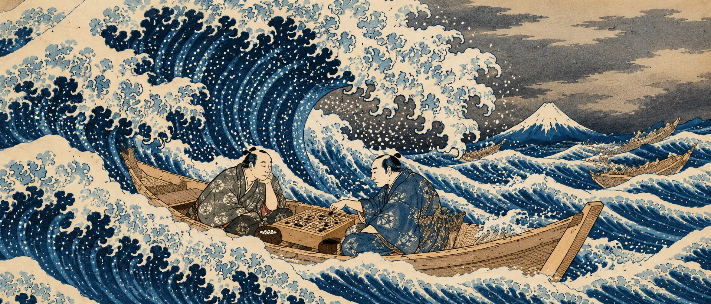

# Tsumego SEA: Solve 'Em All

- In: a tsumego position and side to move
- Out: an SGF with all the reasonable paths and their results

## What counts as a result?

- The game ends immediately when the target dies or lives. Good target selection is key: specify what must survive, including how connections and sacrifices count.
- Results: **alive, seki, ko+n, ko-n, dead**; also **unknown** for unfinished or inconclusive searches.
- **Seki** is deliberately broad: stable mutual life, survival by perpetual repetition, or ruleset-defined no result. Keep the underlying reason internally. Finding a cycle alone is not enough: check whether either player has a better exit.
- Aim for **ruleset-agnostic local solutions**, not whole-game scoring. The broad seki category intentionally merges several repetition outcomes. Flag exceptional cases where legality assumptions (e.g. suicide or superko) change the target outcome.

## Ko model

- Abstract outside moves as **play a threat / respond to a threat**. Threats give a reward but are too small to outweigh the target outcome; each ignored threat has the same unit cost.
- Optimize the target outcome first, then minimize ignored threats. Search with an **ignore-budget**; the smallest sufficient budget determines the ko cost. The sign identifies which side pays (exact sign convention TBD).
- Cap the cost at **10 ignored threats**: beyond that, report a saturated `10+` cost. This is a practical cutoff, not a universal bound. A proven cost beyond the cap is different from an unfinished search.
- Internal threats are real board moves: discover and exploit them to improve the outcome or reduce the outside cost.
- Specify the supply of abstract outside threats. A threat/response exchange represents outside moves, not ordinary passes; define its effect on local ko and repetition explicitly.

## Everybody has a plan until they get punched in the face

1. Determine results for leaf nodes, a la Tsumego Hero determined-by-status.
   - Capture is straightforward; life and seki need sound criteria.
   - KataGo can help estimate difficult group statuses, including multiple-ko positions, but is not a proof oracle and does not evaluate our synthetic ko costs directly.
   - Record why each leaf ends: capture, proven life, estimated status, repetition, or search cutoff.
2. Identify the target stones and relevant playing area.
   - Start with manual markings; automate later. Boundary assumptions must not silently remove liberties, escape routes, or important moves.
3. Build and solve a graph, then export an SGF tree.
   - Cache transpositions, accounting for turn, ko/history, and threat budgets; handle cycles explicitly.
   - Separate solving from presentation: pruning uninteresting SGF variations must not discard necessary defenses from the search.
   - Define “reasonable paths”: winning alternatives, best defenses, and useful mistakes/refutations?
4. Profit.
